# 详情与四任务设置的真实浏览器证据

日期：2026-11-10，Asia/Singapore。实际捕获after源码 `8268f7ba93ea9de8233772697559c64f7d802f56`，before生产基线 `cde887f7bd668048675fb2598443e01ef8a0bfd0`；两者同fixture、数据、主题与宽度，after工作树clean。后续纯文档或Git元数据改变不重新归属这些图像；若引用新head，需提供逐文件等价映射。

最终生产候选 `2773147f6173448591a9a3eac1cd802ba6d59856` 的实际父层为 `37c84f92b1164a9c6e719eb73cd437cb1b198912`。从实际捕获版本重放到最终候选只解决前层文档归档与索引；475个 `packages/`、`tests/`、`apps/` 文件逐字相等，生产、测试及fixture身份由下表固定。此等价关系不改变图像的真实拍摄版本。

批准参考见 [固定v3](../release-visual-target-v3/README.md)，共享工作台累计证据见 [List/Delivery](../release-list-delivery-evidence/README.md)。

这是实际WorkItemApp、WorkspaceSetupGate与client source的本地生产组合，外部port由fixture控制；顶端44px为Host slot envelope，角色为冻结public theme输入。不是已安装Host、真实Provider、#599人类UAT或发布放行。只交付选取的静态PNG与本说明，capture工具不进入产品。

| 场景 | before | after |
|---|---|---|
| detail-light-1440 | 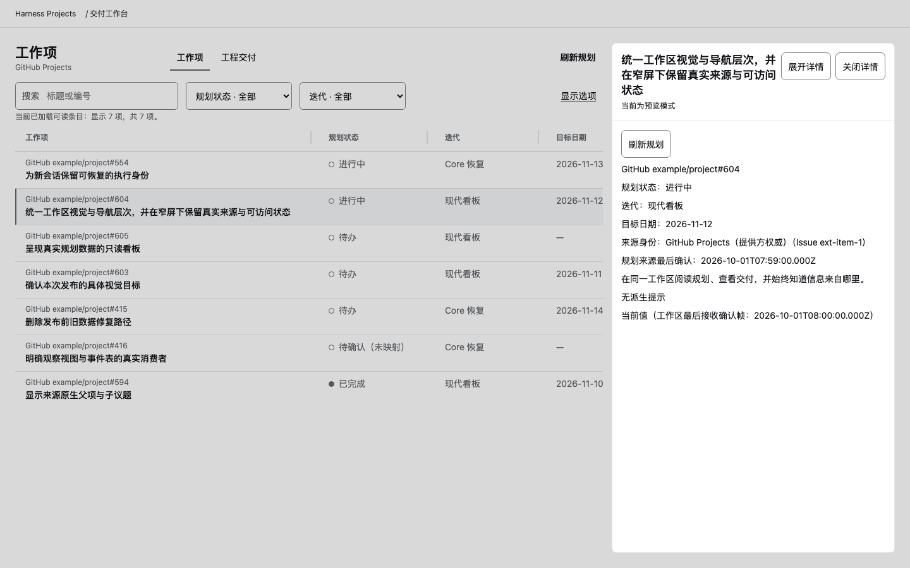 | 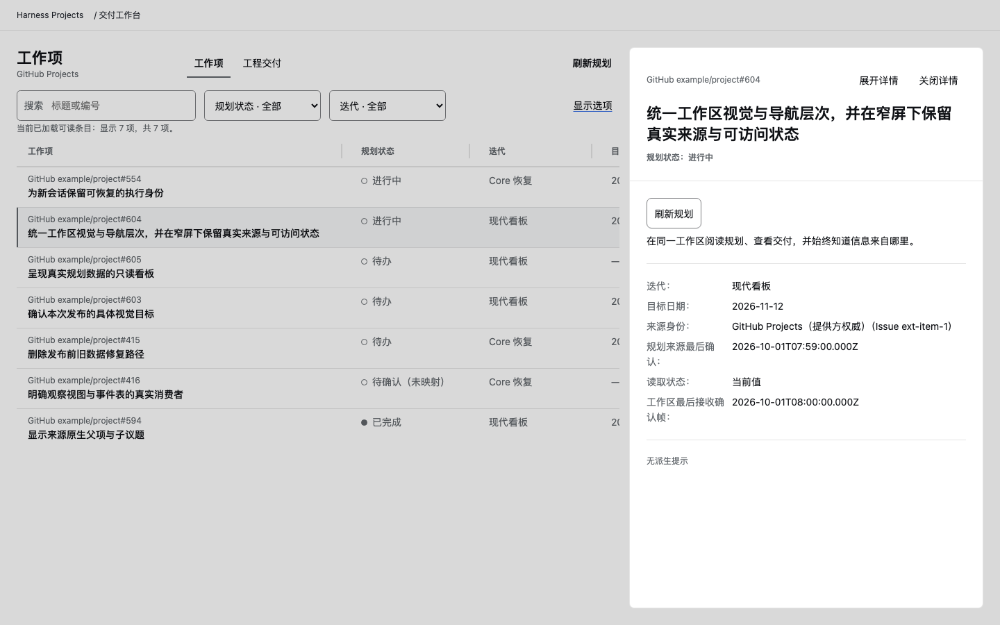 |
| detail-dark-390 | 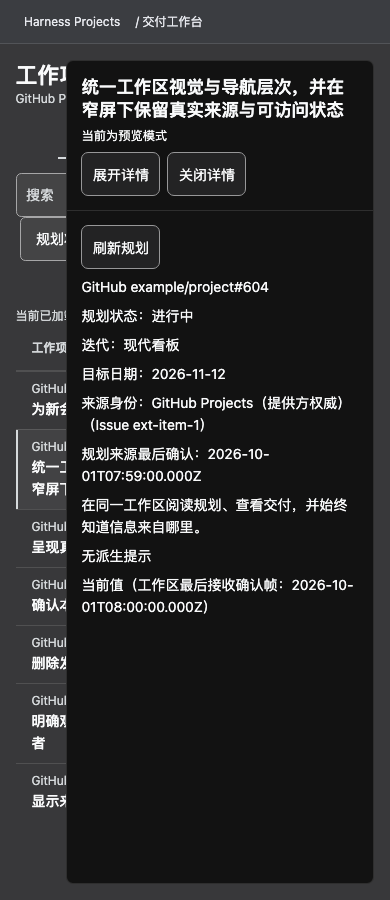 | 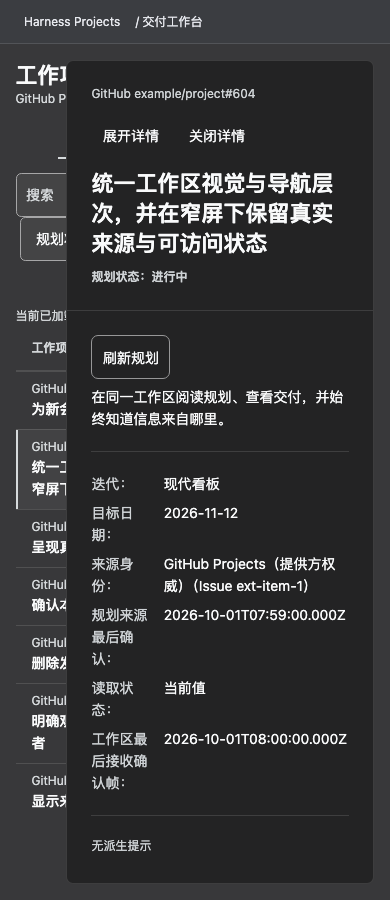 |
| settings-confirmed-light-1440 | 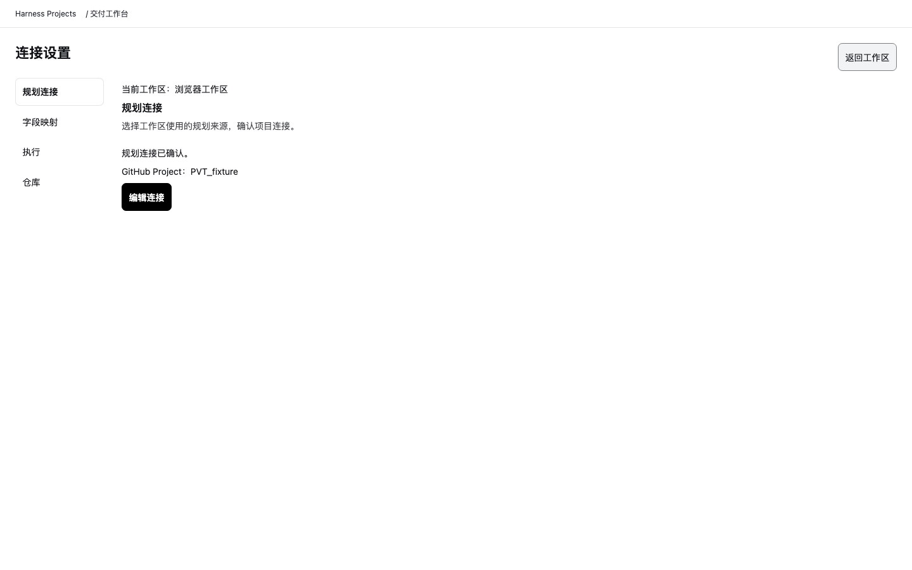 | 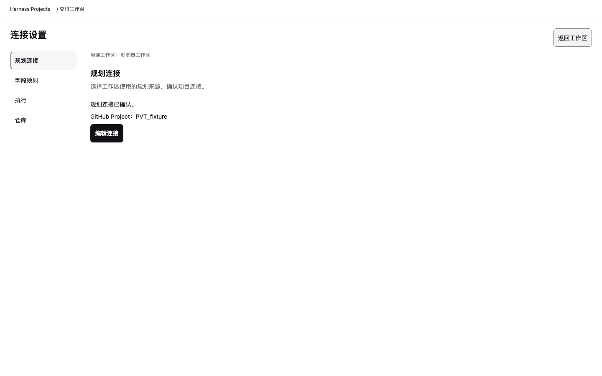 |
| settings-repository-dark-390 | 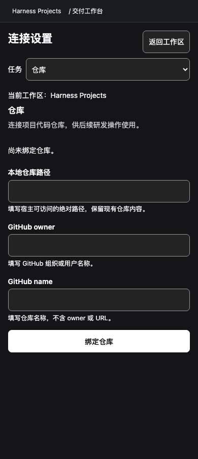 | 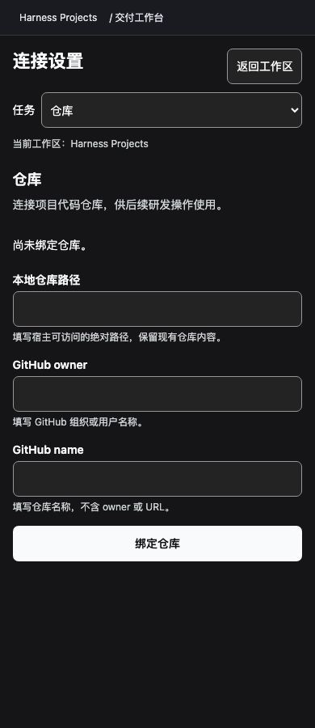 |

390宽真实反馈：

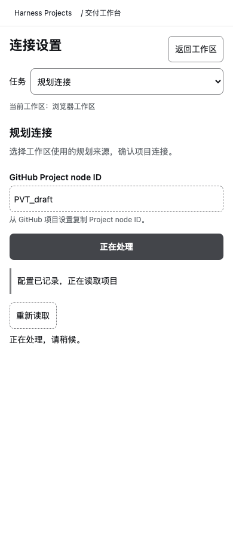

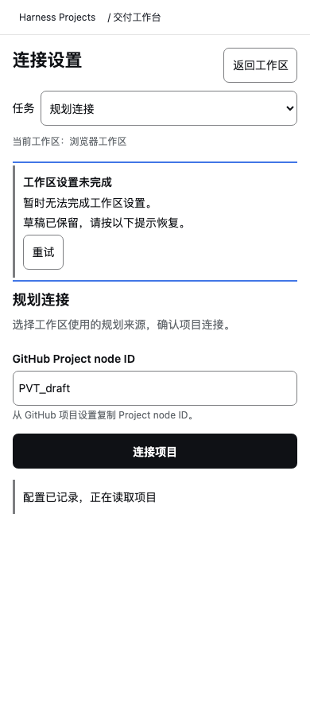

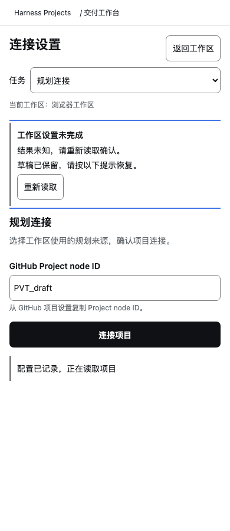

完整before/after各72图：双主题×1440/1200/1024/390，detail8、四任务32、pending/failed/unknown/Host-confirmed read32；另128场景覆盖100/200%文字及无role fallback，零pageerror。新320px/root28/30真实来源编号与metadata判别在累计browser中通过。

Host样式实测：after浅色主按钮字/底为rgb(255,255,255)/rgb(15,17,21)，深色为rgb(15,17,21)/rgb(249,250,251)；背景与字体继承Host角色。before原局部Canvas覆盖保留在图中，未将它伪装成已应用v3角色。focus保持真实pointer modality，没有为截图强制ring。

SourceBefore示例是GitHub example/project中同7项安全条目，编号554/604/605/603/415/416/594；detail为#604。before/after逐行DOM读取值一致。保留真实来源身份与ISO时间、原生modal backdrop/内容矩形/刷新动作及实际能力缺省；未把静态v3示例工程值填入source。Settings configured表单、confirmed read summary和pending/failed/unknown分别捕获，未ack不Saved。

累计pnpm test3961/3961、组合browser74/74、typecheck通过；这不是hosted CI、整页WCAG或安装接受。独立代码/视觉结论及实际bundle见 [本叶ExecPlan](../../exec-plan/completed/2026-11-10-release-workspace-polish.md) 与 [构建证据](../../development/plugin-bundle-evidence.md)。远端门以最终提交回读为准。

源/fixture与参考身份：

| 路径 | SHA-256 |
|---|---|
| `packages/ui/src/detail-presentation.ts` | `6fac95248b48734fda0c3376a9f2be3af9d459faedeb2cdcb02fc578e7d027c4` |
| `packages/ui/src/work-item-detail.ts` | `2f7accc459cce17796e3773abbc492fb51f042426332369566528192b984e0b3` |
| `packages/ui/src/workspace-settings.ts` | `11f34e2977ab0e88fb0cb4fee6b2f08d7a54202e59c13a09adabce09a2beb9c0` |
| `packages/ui/src/form-presentation.ts` | `94df6d2958839a1a83dcc2efb163537ecf0c9893cc27f3314c95d9b1097a2452` |
| `packages/ui/src/markdown-presentation.ts` | `f39e377edbf4cab6452a2a59afb58d869df0d0df364cce9696918842ab27ec66` |
| `tests/fixtures/workspace-frame-browser.mjs` | `26b87a2d10f1364ba8abe4549cd223d9c4ecd0443a8a04206840821c8b5f4d3b` |
| `tests/fixtures/workspace-forms-browser.mjs` | `1a30c2eabc2ce39450a6d54fb57ff6dcf9f549809fd9acca7cfce6da8cc437d3` |
| `tests/browser/detail-expand.test.js` | `ac85a35c50b532242708dba15cdebb0079fc403c073e09be3cdd779d24ef2242` |
| `tests/browser/workspace-settings-presentation.test.js` | `5e93c40535066107e71ac67de30de8f54be4aeb55cb0b55a619027f603fedda7` |
| `tests/contract/ui-work-item-detail.test.js` | `d166a3a6831d7c72959319a629a3ade924296462a9d27012faa6854818912505` |
| `docs/product/release-visual-target-v3/host-role-palette-v3.json` | `21076a06ba918c3464ab54316ce1545febc71782e8224b831d15cc04efa3ca7e` |
| `docs/product/release-visual-target-v3/release-workspace-v3-manifest.json` | `d714cea12faa96bb6411c4e19c3712914af98bad199dd3787cdb419ecbf48c29` |

PNG身份：

| PNG | SHA-256 |
|---|---|
| `before-detail-light-1440.png` | `5aff8405c9704d6825d31635d7012f326519b2b3fc47d8185c356463f1b5b0de` |
| `after-detail-light-1440.png` | `4e9a7907b099e7ba2ee7ef3c36184c99249e9b81d10e32bdffaf40cbb0b2b548` |
| `before-detail-dark-390.png` | `e0710e2878200e3dc985453aa94904c7c3f18ad55b74722b0271a8fcdb901c2c` |
| `after-detail-dark-390.png` | `e7cdccb55e73d6e3fda69681a4140e0cefb4eb5af4be9ca25ed3285695de416e` |
| `before-settings-confirmed-light-1440.png` | `5e2c0f6c5b53699552d2791f97ec692d15ebb838accafdd8716e783eda9c8f8b` |
| `after-settings-confirmed-light-1440.png` | `245367611b8ea8cfffa8e322289e82c56676a503bb06179d4733db96cc3b2a90` |
| `before-settings-repository-dark-390.png` | `94bf5919fe8ed9c06bfcc1e316ad13f9b17cd57e11a3421050b7f34dd6a87c39` |
| `after-settings-repository-dark-390.png` | `0726c1833dfc26da33c79f865b9cb0684018a479c8790da995bcfa12182b8974` |
| `after-settings-pending-light-390.png` | `b1beac7dc7b51981f5fb7c593e0fb26b23416ce78b34de567cfa8cbca928c16e` |
| `after-settings-failed-light-390.png` | `aa59fcf670e762d6f48121af3bc1b0743ab2e36d284c73f6f6ab0ee45012c7bd` |
| `after-settings-unknown-light-390.png` | `53c63514a8cff019c6271d3254ff3a8e9e80cdcf8c763ed4bd7d5223c7eed495` |

## 2026-11-11 MMP 修复对照

[在线连接、条目陈旧及长正文的首视口对照](mmp-stale-source-sheet.png)：同一实际WorkItemApp/client输入，1440与390；来源及条目级当前值/最后已知值与规划状态相邻，完整元数据仍在正文下方。

[320×320、200%文字及超长原生值](mmp-native-metadata-sheet.png)：图中明确区分status滚动位置与raw metadata滚动位置；小视口初始仅见动作栏，不冒称首屏。头部规范“未知”不猜是否未映射，1520字符原生状态、1000字符迭代和950字符身份完整可达；禁止metadata换行的反例已检出。

实际before生产身份为823ff8fa，新增测试/fixture使工作树dirty；三份生产文件精确匹配该baseline。after为clean fec64865，统一使用同fixture/主题/viewport/font和源数据。补充P3中间文案不是最终候选；历史11月10日图像与原SHA保留。局部36、消费者60、边界9与typecheck通过，源会话独立复评结论按对应源哈希复用，最终远端精确提交仍须复评。

[精选图像与技术输入身份索引](mmp-review-evidence.json)记录原PNG hash、crop/scale、source身份和本轮技术文件hash。拼图仅为可查看的静态证据，不把fixture、CI或源码接受当作#599安装、人类UAT或R1放行。原首轮评审与作者逐项RED/GREEN见 `docs/review/pr-615-mmp-review.md`。

串行整合到已批准父层7722df51后，clean630d24d6重新执行28项详情/Delivery/安全投影组合及typecheck，并重拍10张相同输入图；每张PNG与fec64865后图逐字hash相等。精选拼图继续保留原捕获身份，当前整合记录在同一索引，不把历史图改标为新head。
