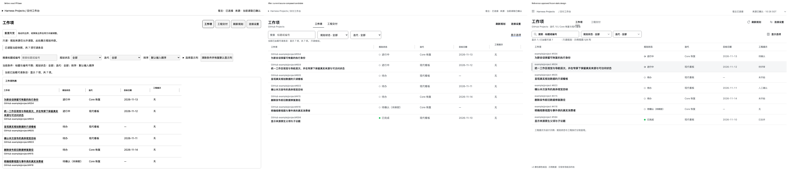
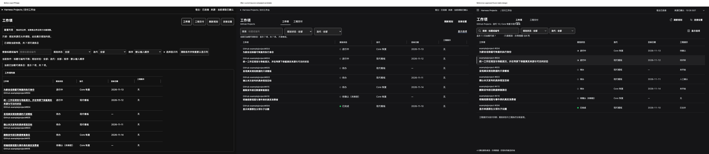
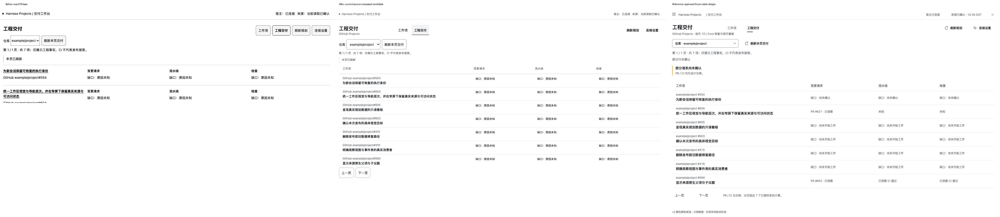
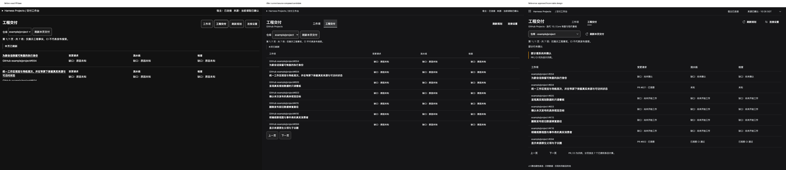
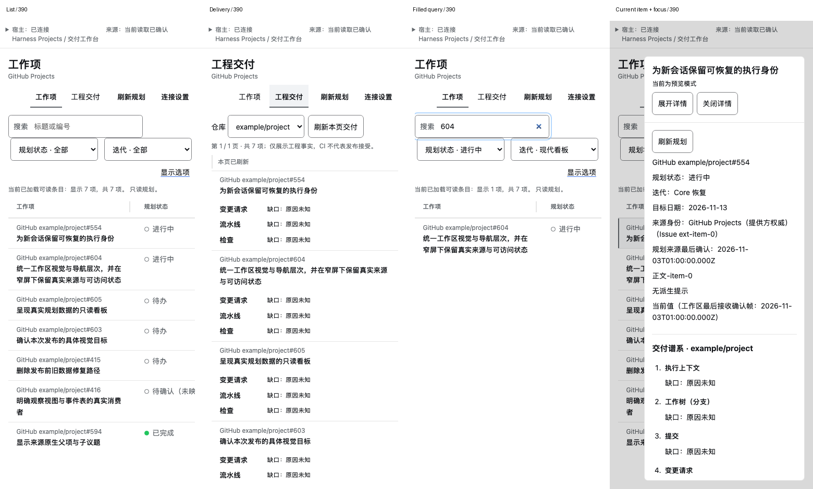
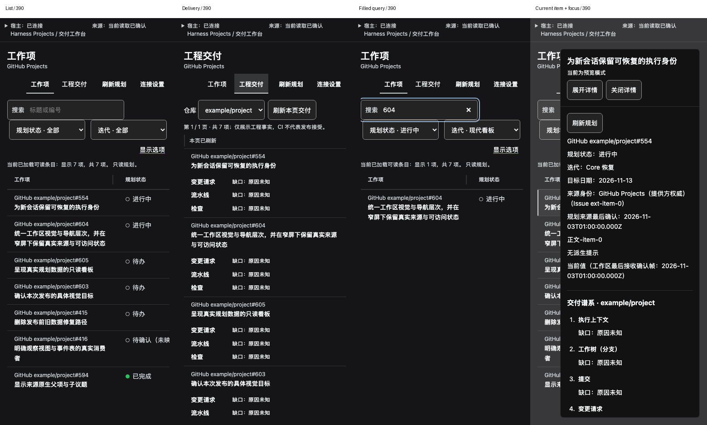

# 共享工作区、List 与 Delivery 源码呈现证据

2026-11-10，Asia/Singapore。本页只覆盖 #614 / PR #611 的能力闭环；完整 #604 还需详情、四任务设置和表单精修的累计验收，实际安装产品由 #599 判断。

## 身份与场景

准确基线为设计父提交 `d449f90b12a114cea78f2de97953a4266204b2b9`，生产候选为 `4c5eff2a908813baf629de7cdc8987fe3e67bb74`，两者捕获与打包时均为 clean。参考为获人类批准的 [release-workspace-v3](../release-visual-target-v3/README.md)，冻结 manifest SHA-256 `d714cea12faa96bb6411c4e19c3712914af98bad199dd3787cdb419ecbf48c29`。

这些画面使用真实生产组件、client EntityStore 与相同七条安全示例；Provider 端口被受控样例替代，工程值“无／缺口原因未知”属于该示例输入。参考中的 PR/CI 文案是设计示例，不据此补造工程事实。来源限定编号、原生状态、迭代与日期保持；默认5显示列、完整8字段访问不改。44px 顶栏是测试环境包络，不是新增产品壳；这不是安装 Host 或完整 Provider→Host 线上链路证据。

精确 before 通过构建钩子读取基线提交生产文件，使用与 after 同一 fixture、主题输入与视口；未改基线工作树。after 在最后生产修改提交后重启载体。公开 Host 默认角色只作为受控主题输入，实际 Host 可覆盖；未引入 theme JS、第二主题状态或新依赖。

## 同主题与同宽比较

1440 图为左 before／中候选／右固定参考；点击原图可放大。390 联系表分别显示 List、Delivery、已填查询以及真实路由选中与焦点。右侧旧详情仅证明唯一实例和回焦，局部 v3 排印由 #604 后层交付。

## 有界验证与观察

本轮独立复核完整主图与状态矩阵，并验证生产/fixture指纹及88份PNG（含联系表、对照与定向截图）。正常1440/1200下表宽1392/1152、表头y195.984/44px、短行58px；390 Delivery普通短行153.17px。长文、异常与文字放大自然增高，不把这些正常样例数值当全局硬高度。

真实交互覆盖查询、排序、全部字段、独立列宽重置、自动/手动列宽与取消恢复、scope切换、拒读和唯一详情焦点；Delivery保留仓库、本页刷新、真实1/1与20项多页、本地末行与分页可达。填值后字段目的常显；真390内容槽内200%末组与分页另有实际滚动截图。源码、功能和视觉分别取证，独立代码与视觉验收均通过。

最初86契约/61浏览器/9边界通过；视觉修复与旧scope契约订正后，相关23浏览器、13渲染契约、15通知契约、1真实scope场景及typecheck通过。独立复验另检查F1/F2与新scope契约，未把旧head结果当新head完整suite；最终当前head必需CI及双向issue/线程由PR门回读。托管旧筛选项文字断言对齐后，完整本地 `pnpm test` 实际通过1550契约、2185集成、226 E2E，共3961且零fail/skip；后层仍需在最终组合源上验收完整 #604。

未验证安装件、所有自定义主题/浏览器/AT或完整WCAG；200% fixture字号验证不等于所有浏览器整页缩放。源安全事实、Host确认与工程事实正交；未写Planning状态或Provider。重放入口是 `tests/fixtures/table-geometry-browser.mjs` 的 reference 场景和对应 header/query/resize/Delivery 浏览器测试；构建入口是 `apps/harness-plugin/scripts/bundle-report.mjs`。

## 公开静态文件指纹

| 文件 | 尺寸 | 字节 | SHA-256 |
|---|---|---:|---|
| `delivery-dark-1440-comparison.png` | 4320×940 | 391350 | `425a1fdb3e03e0d7bf73d47e73133137e420a1891e6ae7ea0dc5351e7fed3f41` |
| `delivery-light-1440-comparison.png` | 4320×940 | 389663 | `33c07f8e83c0d80fae3fc52945902a39c5e53e61335bec76094bc3782b72b99f` |
| `list-dark-1440-comparison.png` | 4320×940 | 444844 | `9203c8b62de060681a3b02df770c4fc37e4a86e8036bdfc7f5f1c6ea7f133c2c` |
| `list-light-1440-comparison.png` | 4320×940 | 443820 | `486d4cbb52f3e1750d7dd22d1e3c286436d92d7d9453209235d75ed1b90aecb2` |
| `narrow-dark-390-sheet.png` | 1560×940 | 313632 | `478b53396780dc441b1009023731bad0a088858c3396c3495216a711795a7951` |
| `narrow-light-390-sheet.png` | 1560×940 | 308607 | `5b209e4d99c7ec070f2fad6aa5d539d8d715401b2368ca4a8e413ca5e999ca6a` |
