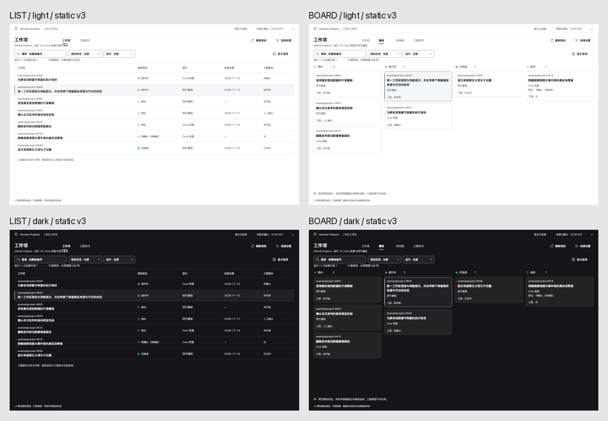

# 首发界面视觉参考：release-workspace-v3

2026-11-10，Asia/Singapore。**人类已明确“批准 v3，开始实施”。** 本版本是 #603 的静态视觉与工程交接，#604/#605据此进入TDD；实际安装产品仍由 #599验收。批准原文、范围及对象见 [ExecPlan](../../exec-plan/completed/2026-11-10-release-visual-target.md#decision-log)。

| 审阅对象 | 入口 |
|---|---|
| 六面与一致性 | [浅色](overview-light-v3.png) · [深色](overview-dark-v3.png) |
| 响应式1200/1024/390 | [浅色](responsive-light-v3.png) · [深色](responsive-dark-v3.png) |
| 源码合成基线与同内容v3 | [对照](source-baseline-v3-comparison.png) |
| 保留v2版式、修订颜色 | [同视口对照](v2-v3-exact-viewport-comparison.png) |
| 控件及页面状态 | [控件](states-light-1440-v3.png) · [页面](page-states-light-1440-v3.png) |
| 配色依据、完整索引及工程约束 | [handoff](handoff-v3.md) · [角色数据](host-role-palette-v3.json) |

[冻结清单](release-workspace-v3-manifest.json)记录35张PNG的SHA-256/字节/尺寸以及两份只读元数据的hash；清单自身SHA-256为`d714cea12faa96bb6411c4e19c3712914af98bad199dd3787cdb419ecbf48c29`。冻结时的未接受描述保留其历史身份，当前接受由ExecPlan记录；任何新的实质视觉变更必须重新具名确认，不能暗改已批准文件。

画面使用7项示例数据，源码基线为`982517c73951563797612472339970f015e7c62f`的生产UI组件+EntityStore合成场景。编号、标题、规划状态、迭代和目标日期匹配；工程提示是单独说明的示意值。**静态稿、源码合成场景、真实composed测试、安装件与人类产品接受分别记录**；当前安装Host/source/artifact身份未由这些图建立。

此版本以公开Host角色为颜色依据，保留已认可的y196/58px正常List/Board几何。小号链接/状态使用清晰中性文字，焦点独立，语义色只作冗余标记；没有整页WCAG或所有Host主题通过的声明。旧v1仅保留[历史指针](../release-visual-target-v1/README.md)。
